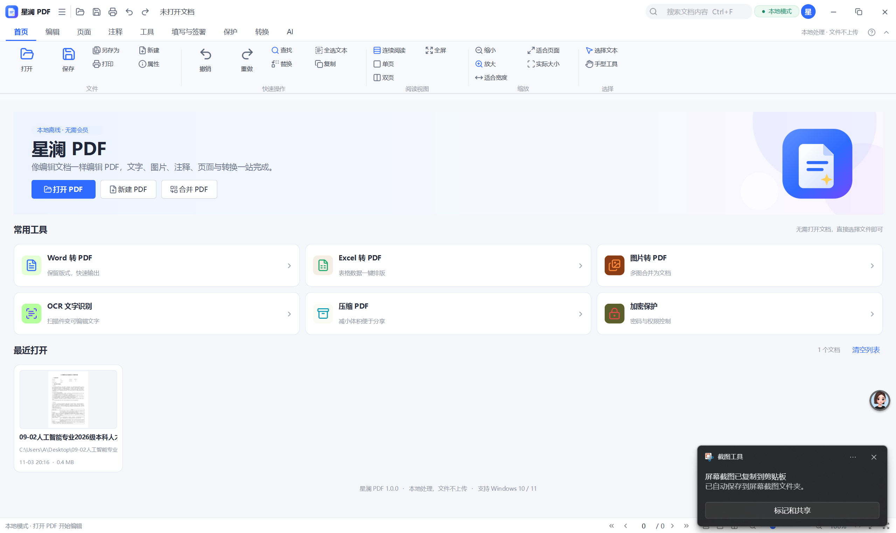
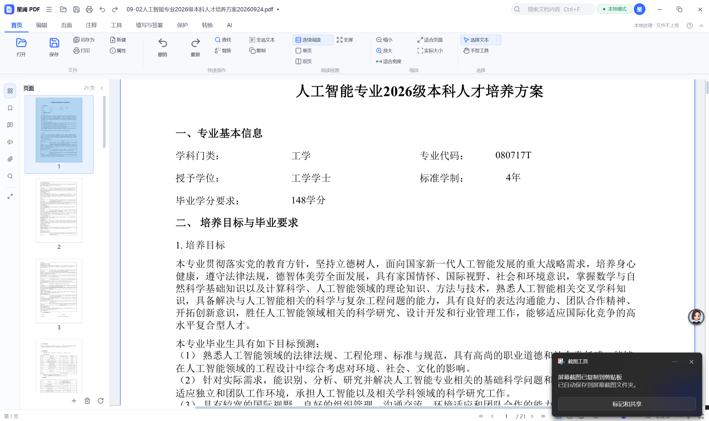

# 第一次周报——用DSH搓了一个PDF文档编辑器
## 一、问题的提出

本周的职业规划课布置了一项实践作业，要求提交PDF文档，当我用WPS打开示例准备对PDF进行编辑时——嗯，被告知要开会员。

对于一个现目前还不经常使用WPS的我来说，直接开通一个月的会员无疑是不划算的。不过最终，在舍友的建议下，我还是成功在闲鱼上找到了价值1.2💰的一日会员，解决了我的燃眉之急。

不过，在被建议去闲鱼上薅会员之前，最先在我脑中蹦出的想法其实是去找网页版的PDF编辑器，于是我找到了“PDF24”这个网页，可是当我把文件导进去过后发现并不好用，或者说我不太会用。于是，用AI搓一个PDF文档编辑器的想法油然而生。

## 二、项目实现过程

起初，在我脑中设想的其实是很快地用DSH搓出来编辑器，毕竟我最终的目的是获得一个永久免费的PDF编辑器，然后尽快完成我的职业规划课作业😄

于是，我很简单地给了DSH一段提示词：

>由于WPS的PDF编辑需要充会员，我需要你给我做一个软件，实现WPS里面PDF编辑的所有功能，WPS里面有哪些功能你自己去网上搜索，我需要你把界面和各个功能的入口做得和WPS一模一样，只是关于WPS这个商标和相应的图标如果设计版权问题你可以自己合理设计类似的图标来代替。你可以在工作区里面新建一个文件夹，自己命名，你工作过程产生的代码或者其他文件都放在你建的这个文件夹下面，但是最终生成的运行程序需要放在工作区的根目录下面，在工作区内，仅对文件级操作和虚拟环境内完成当前任务所必需的命令无需逐次审批；任何可能影响工作区外或系统状态的操作一律禁止。

这段提示词完全是一股脑地把我想到的想法直接告诉了DSH，没有按照标准的工程格式分版块提供提示词（其实当我输入“实现WPS里面PDF编辑的所有功能”这句话时我自己都有点想笑😂）

当他开始跑过后，我渐渐意识到我想的还是太简单了，我开的只是V41-flash，光是第一次呈现作品，就占据了近30%的上下文。然后，不出所料，它第一次跑出来的作品无法运行。

接着，我将报错窗口截图给它，让他修复这个错误，这一次修复我记得上下文长度直接顶到了40%，不过总算成功运行了......

不过，效果是及其不理想的，除了能成功将文件导进去，其他功能几乎完全不能使用，很多按键像是画上去的一样，完全点不开，不过从画面来看，他确实按照要求在尽力复现WPS里面关于PDF编辑的所有功能。

因此，我继续让它修改，由于错误太多，我几乎是直接让他自己排查错误，其实我当时是觉得这是有点无意义的，在我看来以它的视角，用它的各种插件来跑这个项目是完全没问题的才交付给我的，而我不明确给它指出所有问题，他多半是没有优化的方向

第二次给他的提示词：
>不行，错误太多了，除了打开PDF，几乎所有的功能都不可用，几乎所有功能按键都点不了，而且界面的最大化与缩小也用不了，你再给我改，任何可能影响工作区外或系统状态的操作一律禁止，除了你已经生成的文件，我这个电脑系统内的其他任何非你生成的文件你都不许更改，在这个前提下，你的所有步骤都可以不经过审批，自己走完整个项目全程，再次提醒，你可以操作的区域仅在工作区内。

不过，出乎我意料，第三次输出的项目竟然已经可以正常使用了，所有功能按键都有反应，并且相应的功能都有模有样的，虽然距离真正的WPS差之甚远，但是已经可以简单做一些文档修改了。

为了让他继续优化，我类似的继续给他提要求，继续优化，此处就不继续写了......

现目前，这个程序至少对PDF做一点简单地改动还是可以执行的，具体的程序附在文件夹里了。

## 三、实例截图展示

## 四、反思与总结

其实在第一步程序无法运行的时候，我就已经放弃了通过搓一个PDF编辑器来完成作业的想法，转而用WPS先把作业完成。

但是，我却对DSH能做到哪一步很好奇，或者说我对我能让DSH做到哪一步很好奇，所以才有了后面继续的探索。

在我向DSH发出指令的时候，我常常会感到一种词穷的无力感，这不是文字意义上的词穷，而是我对于DSH在干嘛、整个项目是怎么做起又是经历了什么最后又是怎么结束的完几乎是一片空白，甚至于我对于PDF编辑器本身需要一些什么功能，这些功能是靠什么来实现的也几乎完全不知道，在这次尝试中，**我真的感觉自己就只是一个保安**😂。我曾问过AI，用DSH复现一整个WPS可能吗，它告诉我：不能。试想，如果我能了解整个项目的来龙去脉，具体详细地告诉AI需要实现的功能，甚至于告诉AI具体的工作方向，而AI多数被用作在指定方向上进行程序编写，那么短时间内复现WPS也并非不可能。

## 五、项目未来
我把项目放在了[我的公开仓库](https://github.com/Wowmoment-code/Public-Showing-for-Club/tree/main/PDF%E7%BC%96%E8%BE%91%E5%99%A8%E9%A1%B9%E7%9B%AE/PDF%E7%BC%96%E8%BE%91%E5%99%A8/StellarPDF)，尽管它其中还有很多待完善的地方，甚至如果要想上线还需要大改，不过短期内我不打算将精力投入该项目的继续开发，等哪次有空了或者有需要再继续跟进吧。

