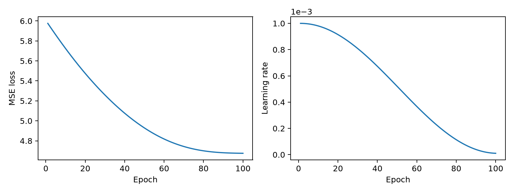

# week1周报

## 一、深度学习与优化方法

完成了 PyTorch 基础操作的学习与环境配置，重点梳理了梯度下降、学习率设置以及反向传播的基本过程。

### 1. 梯度下降

围绕参数更新公式展开学习：

$$
\theta_{t+1}=\theta_t-\eta_t\nabla_\theta L(\theta_t)
$$

重点分析了学习率对训练过程的影响：学习率过大时，可能在最优点附近震荡，甚至导致损失发散；学习率过小时，参数更新缓慢，收敛效率较低。同时了解了学习率衰减的思路，通过在训练后期减小更新步长，兼顾前期的收敛速度与后期的优化精度。

此外，结合特征标准化，进一步理解了不同特征尺度对梯度和优化路径的影响。（补了一下之前漏掉的知识）

### 2. 反向传播与训练流程

梳理了计算图与链式法则之间的联系，重点理解损失如何逐层传递梯度，以及参数如何根据梯度完成更新。

进一步整理了 PyTorch 中的训练流程，包括：

- 前向计算与损失构建；
- 梯度清零与反向传播；
- 参数更新与学习率调度。

下面是整理的训练循环示例，同时将梯度裁剪与余弦学习率调度接入同一流程：

```python
import torch
from torch import nn

model = nn.Sequential(
    nn.Linear(8, 32),
    nn.ReLU(),
    nn.Linear(32, 1),
)

optimizer = torch.optim.AdamW(
    model.parameters(), lr=1e-3, weight_decay=1e-4
)
scheduler = torch.optim.lr_scheduler.CosineAnnealingLR(
    optimizer, T_max=100, eta_min=1e-5
)
criterion = nn.MSELoss()

# 随机构造回归数据，用于检查训练流程
x = torch.randn(256, 8)
y = 2 * x[:, :1] - x[:, 1:2] + 0.1 * torch.randn(256, 1)

model.train()
for epoch in range(100):
    optimizer.zero_grad(set_to_none=True)
    loss = criterion(model(x), y)
    loss.backward()
    torch.nn.utils.clip_grad_norm_(model.parameters(), max_norm=1.0)
    optimizer.step()
    scheduler.step()

    if (epoch + 1) % 20 == 0:
        lr = scheduler.get_last_lr()[0]
        print(f"epoch={epoch + 1:03d} loss={loss.item():.4f} lr={lr:.2e}")
```



后续准备对比固定学习率与学习率衰减下的损失曲线，进一步验证对优化过程的理解。

## 二、数学

一直在被数学竞赛的题目殴打，一般通过题目学习，结合题目巩固分析方法与计算技巧，同时复习一些课内的内容。

当前主要需要提高的是解题思路的独立构建（感觉每次做新题都能学到没接触过的技巧），还有一些证明过程的完整性。（CMC马上开始了，谁来救救孩子😭）

## 三、具身智能

因为对这个方向比较感兴趣，就浅浅地学习了一点，阅读了 RoboTwin 2.0 论文的相关内容，重点梳理域随机化、策略鲁棒性与 sim-to-real gap 之间的关系，关注仿真数据的多样性如何帮助策略适应环境变化。

之后的话会以 RoboTwin 仿真任务为入口，结合 ACT 了解模仿学习中示范数据、策略训练与任务评估的基本流程，逐步推进环境配置和基础实验。

## 四、先导杯学习与实践

参与了这个先导杯。关于 ProGen2 模型推理优化，主要靠GPT大人，我也尝试理解了一些代码、修改程序和分析实验结果。与前面的训练基础学习不同，这部分实践主要关注固定模型在推理阶段的执行效率。目前对整体优化流程有了初步认识，底层算子的实现还需要继续学习。（队友不管了，只剩我一个人还是太累了）

### 1. 使用的优化方法

- **预计算与缓存：** 提前准备与具体输入无关的位置编码数据，使用静态 KV 缓冲区，减少生成过程中的重复计算、内存申请和数据拼接。
- **算子融合：** 将部分相邻的小操作合并，尝试减少中间数据读写和算子启动开销。
- **权重布局调整：** 调整权重在显存中的存放方式，尝试提高小批量矩阵计算的执行效率，同时保留原始权重数值。
- **图捕获与重放：** 将反复执行的推理操作捕获为图，在后续生成时重放，减少 CPU 逐个提交算子的开销。
- **批量验证：** 利用本次请求内的历史内容提出候选，再交给原模型进行批量验证，尝试减少逐个生成的开销。实际收益与候选接受情况有关。


### 2. 大概效果

目前保留版本在四轮完整公开测试中，四项任务与公开 FP32 参考的字母一致率均为 **100%**。四项合计耗时从最初约 **40 秒** 降到不到 **4 秒**，按耗时合计估算约加速 **10 倍**。


### 3. 学习内容与体会

- 初步了解了容器、DCU、PyTorch 和 HIP/DTK 的作用，认识到软件版本和资源配置也是实验的一部分。
- 理解了自回归生成、贪心选择和 KV Cache 的基本用途，知道模型为什么需要反复执行相似的计算。
- 接触了浮点精度和误差传播：单个算子的数值差异很小，也可能改变某一步选择，进而影响后续生成结果。
- 开始学习区分计算、内存访问、算子启动和 CPU/GPU 同步等不同开销。

# ps
感觉周围全是佬啊，我在其中瑟瑟发抖，还得多多学习啊


