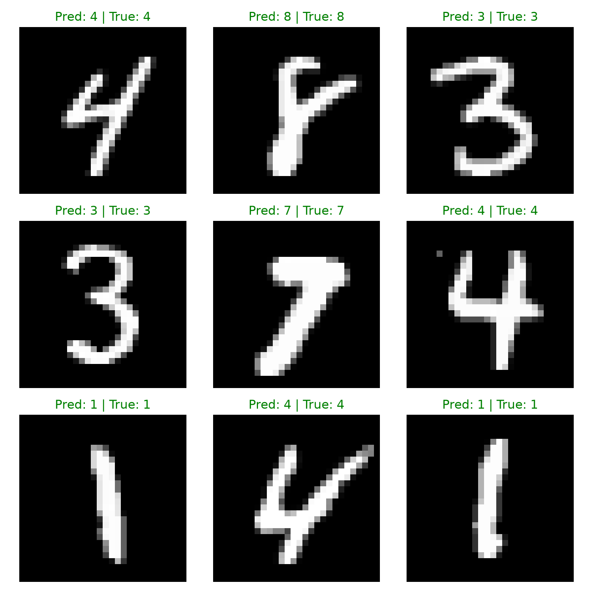

# week3

## 一、概述

本周主要搞了一些课内的东西，然后就是使用 PyTorch 完成了这个 MNIST 数据集的卷积神经网络手写数字分类的项目。

## 二、数据与实验配置

- **数据集**：MNIST，训练集 60,000 张，测试集 10,000 张；灰度图，尺寸 28 × 28，类别为数字 0–9。
- **开发环境**：Windows、Python、PyTorch、torchvision。
- **计算设备**：NVIDIA RTX 5060，使用 CUDA 训练。
- **预处理**：`transforms.ToTensor()`，将图像转换为张量并把像素值缩放到 `[0, 1]`。
- **训练参数**：`batch_size=64`，`epochs=3`，Adam 优化器，学习率 `0.001`，交叉熵损失。

### 代码 1：数据加载

```python
from torchvision import datasets, transforms
from torch.utils.data import DataLoader

train_dataset = datasets.MNIST(         
    root="./data",                      #放到data文件夹
    train=True,                         #加载训练集
    transform=transforms.ToTensor(),    #数据预处理，将PIL变成Pytorch张量；改变维度顺序；归一化
    download=True,                      #不存在就尝试下载
)
train_loader = DataLoader(train_dataset, batch_size=64, shuffle=True)    #分批，shuffle为随机打乱
```

- `Dataset` 负责提供单个样本及标签，`DataLoader` 负责将样本组织为批次。通常每批输入形状为 `(64, 1, 28, 28)`。
- batch_size设定为2的幂次方，以和显存完美对齐。
- 了解了Full Batch、SGD、Mini-Batch三种策略。

## 三、模型结构与实现

这个 CNN 包含两组“卷积 + ReLU + 最大池化”，之后通过展平层和两层全连接层输出 10 个类别的分数。

| 网络操作 | 输出形状（batch=64） |
|---|---|
| 输入 | `(64, 1, 28, 28)` |
| 卷积 1 + ReLU | `(64, 16, 28, 28)` |
| 最大池化 1 | `(64, 16, 14, 14)` |
| 卷积 2 + ReLU | `(64, 32, 14, 14)` |
| 最大池化 2 | `(64, 32, 7, 7)` |
| Flatten | `(64, 1568)` |
| 全连接 1 + ReLU | `(64, 128)` |
| 全连接 2 | `(64, 10)` |

### 代码 2：CNN 模型（`model.py`）

```python
import torch
from torch import nn

class MyCNN(nn.Module):                                   #继承
    def __init__(self):
        super().__init__()
        self.conv1 = nn.Conv2d(1, 16, 3, padding=1)
        self.conv2 = nn.Conv2d(16, 32, 3, padding=1)
        self.pool = nn.MaxPool2d(2, 2)
        self.relu = nn.ReLU()
        self.fc1 = nn.Linear(32 * 7 * 7, 128)
        self.fc2 = nn.Linear(128, 10)

    def forward(self, x):
        x = self.pool(self.relu(self.conv1(x)))
        x = self.pool(self.relu(self.conv2(x)))
        x = torch.flatten(x, 1)
        x = self.relu(self.fc1(x))
        x = self.fc2(x)
        return x
```

其中卷积层提取局部特征，ReLU 引入非线性，最大池化减小空间尺寸，最后由全连接层输出类别分数。

## 四、训练流程与实验结果

### 代码 3：部分训练循环核心逻辑

```python
criterion = nn.CrossEntropyLoss()
optimizer = torch.optim.Adam(model.parameters(), lr=0.001)

model.train()
for images, labels in train_loader:
    images = images.to(device)
    labels = labels.to(device)

    outputs = model(images)             # 前向传播
    loss = criterion(outputs, labels)   # 计算损失

    optimizer.zero_grad()               # 清空已有梯度
    loss.backward()                     # 反向传播，计算梯度
    optimizer.step()                    # 更新模型参数
```

以上为部分训练循环代码，`model` 和 `device` 需要在前面初始化。
### 实际训练记录

| Epoch | 平均 Loss | 训练准确率 |
|---|---:|---:|
| 1 | 0.2350 | 92.84% |
| 2 | 0.0636 | 98.03% |
| 3 | 0.0450 | **98.61%** |

训练过程中损失逐渐下降，训练准确率持续提高。

### 测试集结果

| 指标 | 结果 |
|---|---:|
| 测试样本数 | 10,000 |
| 正确分类 | 9,856 |
| 错误分类 | 144 |
| **测试准确率** | **98.56%** |


### 代码 4：部分模型加载与测试

```python
model = MyCNN().to(device)
model.load_state_dict(
    torch.load("mnist_cnn.pth", map_location=device, weights_only=True)
)
model.eval()

correct = 0
with torch.no_grad():
    for images, labels in test_loader:
        images, labels = images.to(device), labels.to(device)
        outputs = model(images)
        predictions = outputs.argmax(dim=1)
        correct += (predictions == labels).sum().item()

print(f"Test Accuracy: {correct / len(test_dataset) * 100:.2f}%")
```

此处的 `test_loader`、`test_dataset` 和 `device` 需要预先创建。`model.eval()` 切换至评估模式，`torch.no_grad()` 关闭梯度记录以减少评估开销。

## 五、预测可视化

编写了 `predict.py`，加载保存的模型权重，对测试集中的 9 张图片进行预测，并用 matplotlib 生成 3 × 3 的可视化图片 `mnist_predictions.png`。

**** 

### 代码 5：部分可视化逻辑

```python
fig, axes = plt.subplots(3, 3, figsize=(8, 8))
for i, ax in enumerate(axes.flat):
    ax.imshow(images[i].squeeze().cpu(), cmap="gray")
    pred = predictions[i].item()
    true = labels[i].item()
    ax.set_title(f"Pred: {pred} | True: {true}",
                 color="green" if pred == true else "red")
    ax.axis("off")

plt.tight_layout()
plt.savefig("mnist_predictions.png", dpi=200)
plt.show()
```

